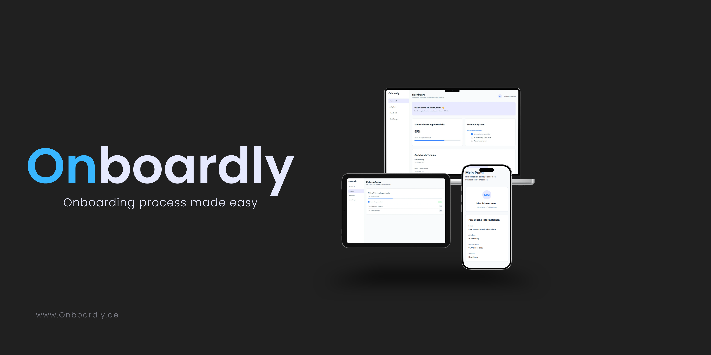
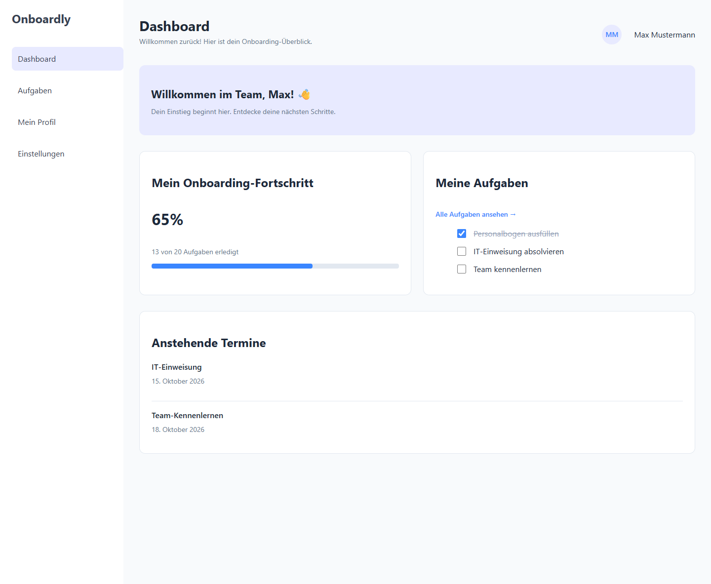
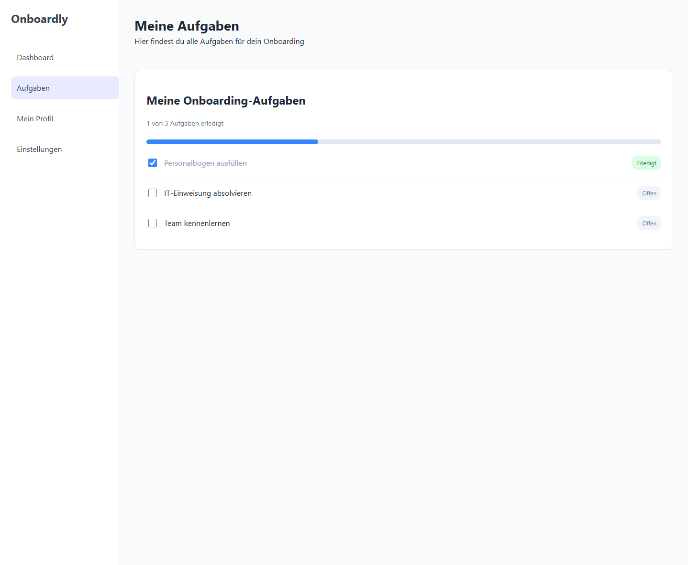
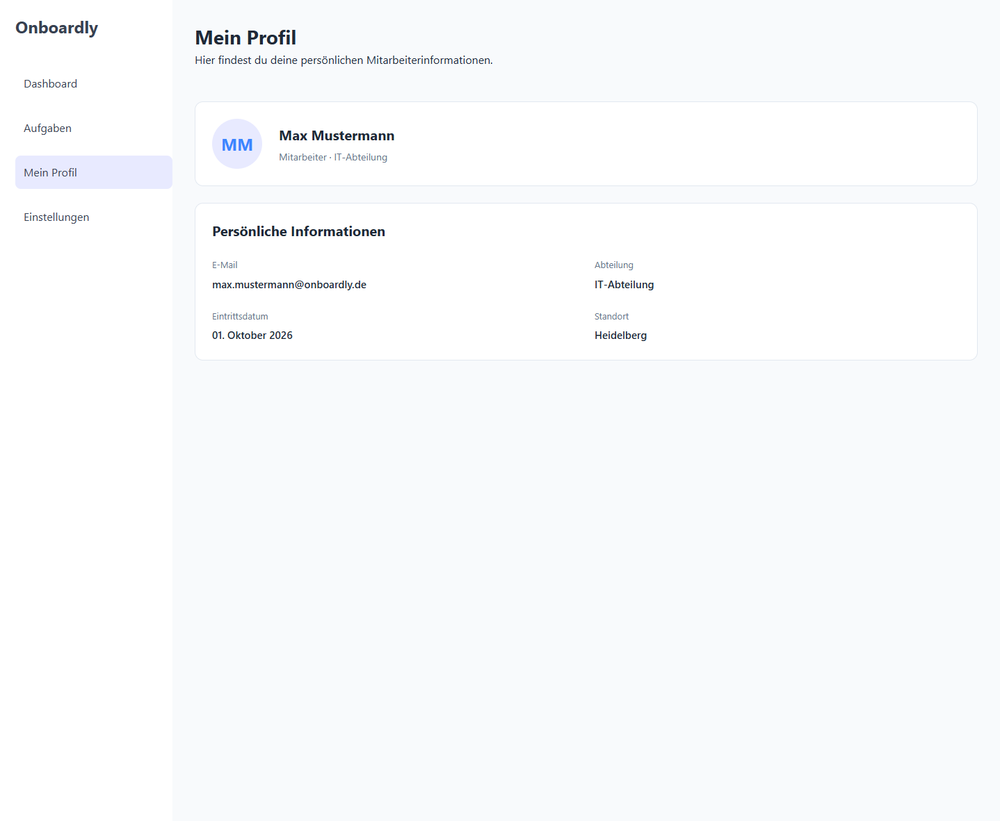
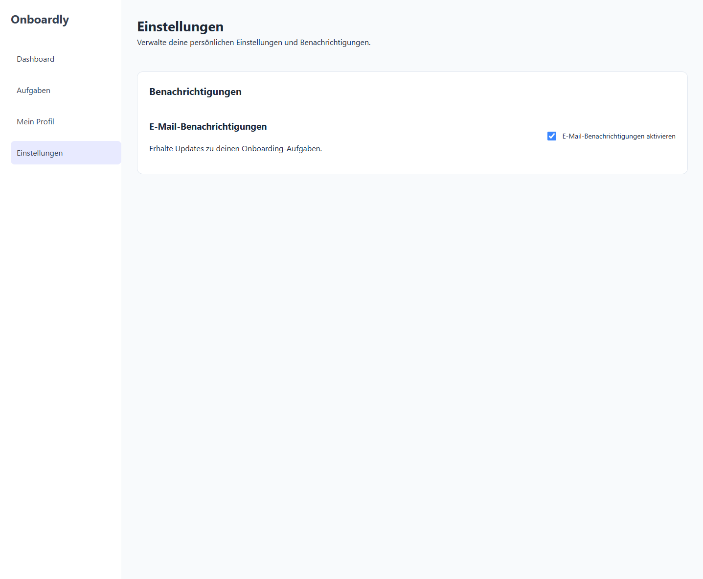
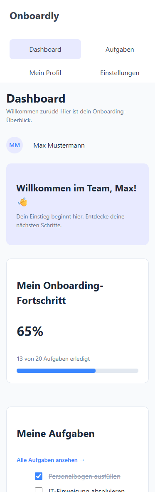
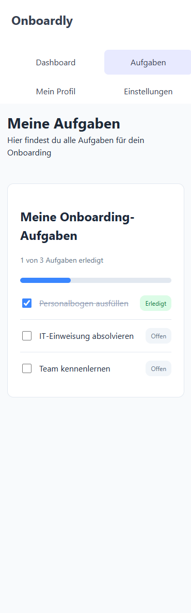
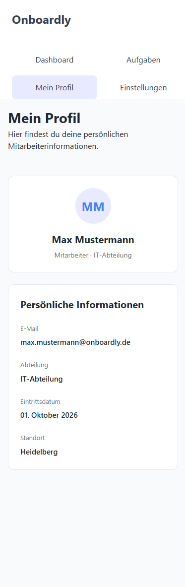
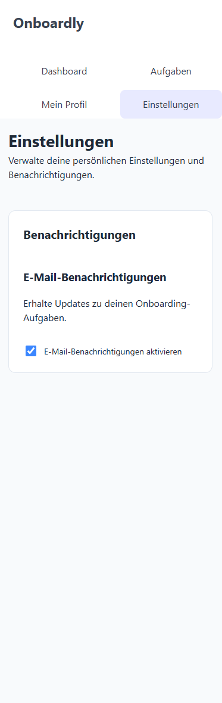

# Onboardly

Onboarding-Process made easy

Onborading-Process made easy

## Über das Projekt

Onboardly ist ein fiktives Onboarding-Dashboard,
das neue Mitarbeitende bei ihrem Einstieg
in ein Unternehmen unterstützt.

## Funktionen

- Responsive Dashboard mit Onboarding-Fortschritt
- Aufgabenübersicht mit anklickbaren Checkboxen
- Mitarbeiterprofil mit persönlichen Informationen
- Einstellungen für E-Mail-Benachrichtigungen
- Navigation zwischen vier HTML-Seiten

## Verwendete Technologien

- HTML5 – Semantische Struktur der Webseiten
- CSS3 – Gestaltung und responsive Layouts
- Flexbox – Ausrichtung von Elementen
- CSS Grid – Aufbau mehrspaltiger Layouts
- Git & GitHub – Versionsverwaltung

## Entwicklungsstand

Onboardly befindet sich in der Entwicklung.
Aktuell wurde die Benutzeroberfläche mit HTML und CSS umgesetzt.
Geplant sind:

- JavaScript für dynamische Aufgabenverwaltung
- Automatische Aktualisierung des Fortschritts
- Speicherung von Benutzereinstellungen

## Vorschau

### Dashboard

### Aufgabenübersicht

### Profilansicht

### Einstellungen

### Mobile Ansicht

## Live-Demo

🌐 [Onboardly live ansehen](https://luka-radosavljevic.github.io/Onboardly/)
